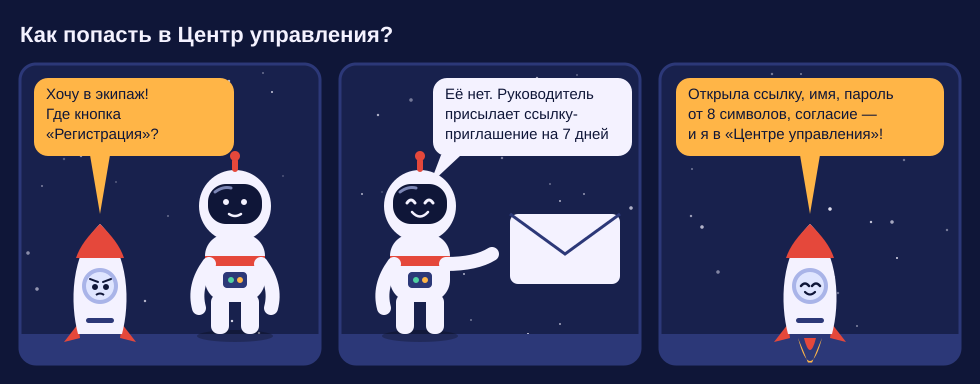
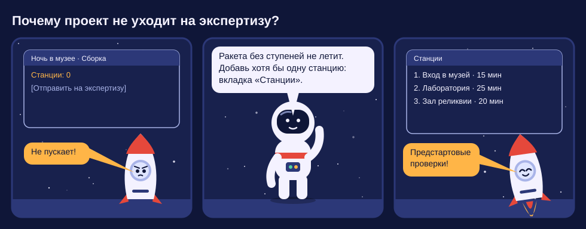
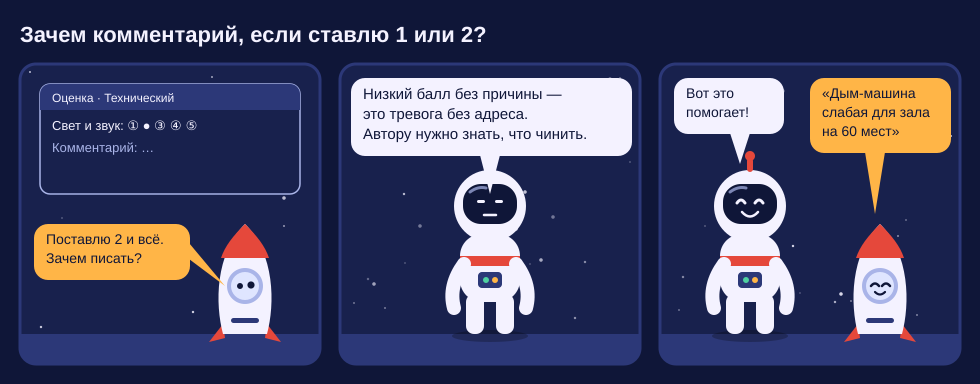
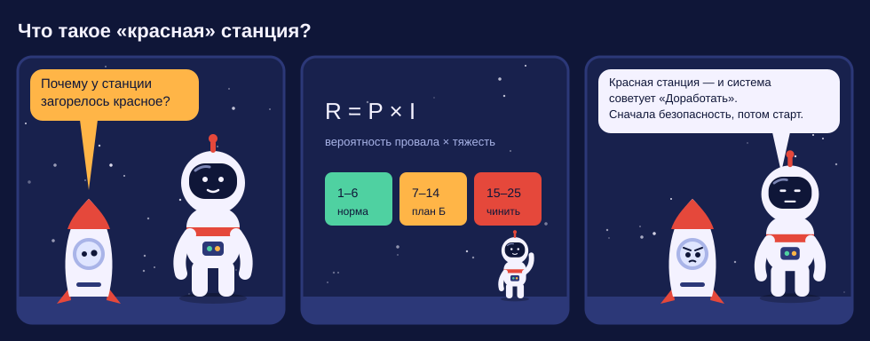
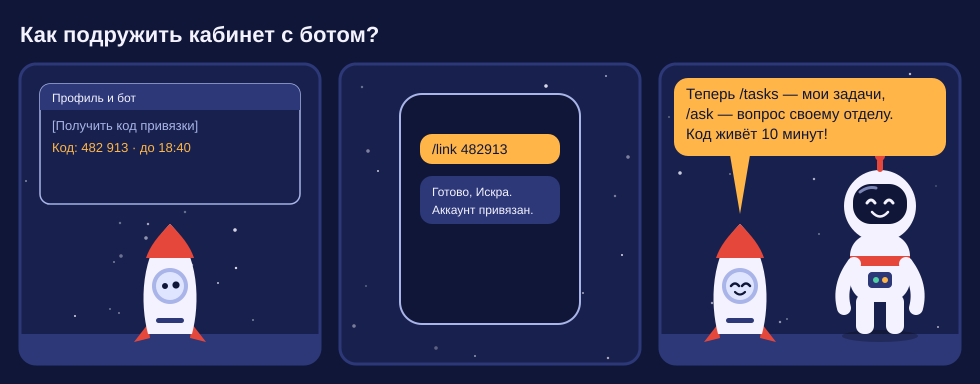
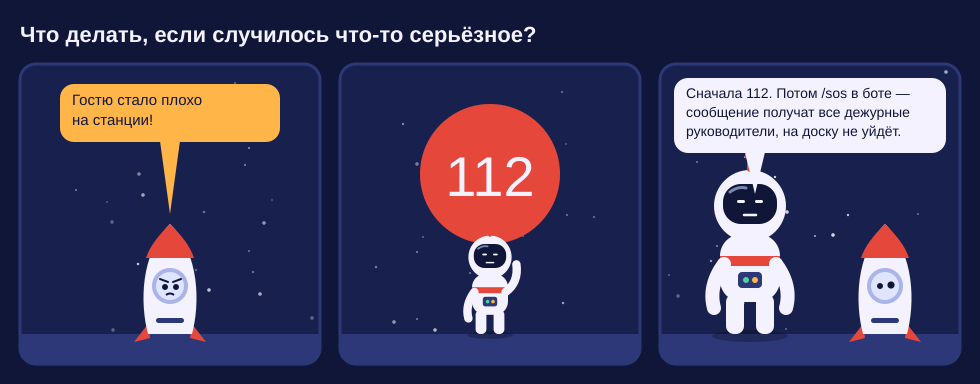
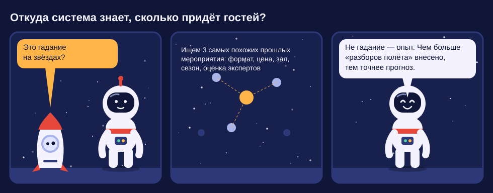
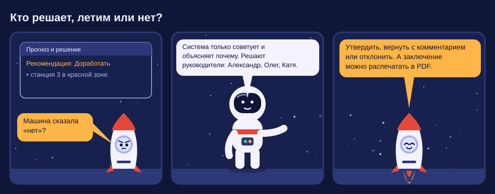

# FAQ Energy Lab в комиксах

Знакомьтесь: **Капитан Лаба** руководит полётами, а **Искра**, ракета-стажёр, задаёт вопросы.
Каждый комикс — один частый вопрос. Под картинкой дан короткий текстовый ответ: его можно скопировать или найти поиском.

> Персонажи и рисунки нарисованы для Energy Lab с нуля: `docs/faq/make_comics.py` генерирует SVG.
> Чтобы добавить вопрос, допишите вызов `strip(...)` и запустите скрипт.

---

## 1. Как попасть в Центр управления?

Открытой регистрации нет. Руководитель присылает ссылку-приглашение, она действует 7 дней. По ссылке укажите имя, пароль от 8 символов и дайте согласие на обработку данных. → [Руководство пользователя, п. 3.2](../guides/user.md#32-первый-вход)

## 2. Почему проект не уходит на экспертизу?

Без станций проект на экспертизу не отправить. Добавьте хотя бы одну станцию во вкладке «Станции». → [п. 4.2.2](../guides/user.md#422-добавить-станции)

## 3. Зачем комментарий, если ставлю 1 или 2?

Низкий балл без причины ничего не говорит автору. Поэтому при 1 или 2 система просит комментарий. Во втором туре комментарий нужен ещё и тогда, когда вы меняете свой балл больше чем на 1.

## 4. Что такое «красная» станция?

Риск станции R равен вероятности провала P, умноженной на тяжесть последствий I. Обе величины — от 1 до 5.

* 1–6 — зелёная зона;
* 7–14 — жёлтая, нужен план «Б»;
* 15–25 — красная, станцию нужно переделать.

Если хоть одна станция красная, система рекомендует «Доработать». → [Приложение А](../guides/user.md#приложение-а-шкала-оценок-и-зоны-риска)

## 5. Как подружить кабинет с ботом?

1. Откройте «Профиль и бот» и нажмите «Получить код привязки».
2. Отправьте боту `/link КОД` в течение 10 минут.

После этого работают команды `/tasks` (мои задачи) и `/ask` (вопрос отделу). Если Telegram тормозит, выберите в профиле ВКонтакте.

## 6. Что делать, если случилось что-то серьёзное?

Сначала **112**. Потом отправьте `/sos` в боте: сообщение сразу получат все дежурные руководители. На публичную доску оно не попадает.

## 7. Откуда система знает, сколько придёт гостей?

Система ищет три самых похожих прошлых мероприятия. Сравнивает формат, цену, вместимость, сезон и оценку экспертов, а затем переносит их результаты на ваш проект. Чем больше разборов полёта внесено, тем точнее прогноз. → [ЧТЗ М-05](../chtz/M05-forecast.md)

## 8. Кто решает, летим или нет?

Система советует и объясняет почему, а решают руководители. Они могут утвердить проект, вернуть его на доработку с комментарием или отклонить. Заключение можно распечатать или сохранить в PDF.

---

## Ещё вопросы без картинок

**Можно поменять проект, пока идёт экспертиза?**
Нет. Менять проект можно только в стадиях «Сборка» и «Возврат на доработку», иначе эксперты оценивали бы движущуюся цель.

**Я эксперт, но не вижу проект.**
Эксперт видит проект, только если руководитель его назначил. Оценивать можно, только пока тур открыт. Проверьте блок «Ждут вашей оценки» на обзоре.

**Почему я не вижу оценки коллег?**
До закрытия тура оценки скрыты, чтобы мнения были независимыми. Это метод Дельфи.

**Что значит «согласованность W»?**
W — это коэффициент Кендалла от 0 до 1, он показывает, насколько эксперты единодушны. Если W меньше 0,5, руководитель может открыть второй тур. В нём каждый увидит медиану первого тура.

**Мои данные уходят в Telegram или Google?**
Нет. ФИО, почта, телефоны и анкеты хранятся на сервере в России. В мессенджер приходит только текст уведомления со ссылкой. В Google Диск выгружаются данные о мероприятии без данных гостей.

**Забыл пароль.**
Попросите руководителя прислать новое приглашение на ваш e-mail. По нему вы зададите новый пароль.

**Гость купил билет, но не пришёл. Возврат?**
Возвраты проводит Timepad по ст. 52.1 Основ законодательства о культуре:

* больше 10 дней до мероприятия — 100 %;
* 5–10 дней — 50 %;
* 3–5 дней — 30 %;
* меньше 3 дней — только по уважительной причине.
